# Recovering missing asset attributes
## Final capstone report

**Rishank Goyal · Team 19 · Subteam A** 
University of Adelaide · SA Power Networks

**Study scope.** A synthetic transformer benchmark from Subteam C, a synthetic overhead conductor transfer, and matched follow-ups on grouped gaps, structural errors and screening. The principal benchmark contains 123 completed scenario × seed × split tasks. All reported results are transcribed or aggregated from the saved evidence.

**Reading guide.** Sections 1–5 describe the question and protocol. Sections 6–13 report the evidence. Section 14 lists limits. Section 15 gives the field and method verdicts, recommendations and earlier predictions.

**At a glance.** MissForest led the original feature-enabled anchor at 0.656 mean numeric skill. With grouped gaps it fell to 0.264. Matching the MLP training masks raised grouped skill to 0.453. The screening pilot shows how a separate check can flag suspicious values already in a record.

## 1. Purpose

The research question is how reliably missing asset attributes can be recovered, how well the completed register preserves the population, and when the available evidence warrants review or abstention. The intended use is to improve inputs to existing asset decisions and reliability models. The downstream exercise measures sensitivity to filled inputs in a synthetic setting.

We compare three learned imputers against transparent references. Point accuracy, uncertainty, distribution, downstream ranking and formula consistency are evaluated separately because success on one does not imply success on the others.

## 2. Data

The primary source is Subteam C’s synthetic transformer generator. It creates a 100 × 100 location grid, tracks installation order, and supplies measured and clean reference values. Location and installation day are strongly linked in this generator. The model-dependent gases, environmental variables, life outcome and random placebo allow us to compare recoverable, weakly identified and uninformative targets. Clean truth is held outside model fitting. The original supplied pairs are audited cell for cell against the generator before use.

The overhead study uses a separate synthetic conductor register derived from the team’s pilot work. Its historical context is SA Power Networks’ October 2014 *Asset Management Plan 3.1.10, Overhead Conductor*, published by the Australian Energy Regulator. The benchmark uses prepared, aligned clean and measured pairs, with feeder identifiers used only to define held-out groups. It evaluates eight fields. Real operational tolerances remain a question for SAPN.

**Source coverage**

| Source | Rows per clean table | Evaluated fields | Inputs |
| --- | --- | --- | --- |
| Transformers | 10,000 | 15 | 9 original clean/measured pairs |
| Overhead conductors | 10,000 | 8 | 4 prepared clean/measured pairs, feeder ID retained for grouping |

**Why.** The generator and paired truth let us score only hidden entries while keeping the measured inputs intact. The two asset classes carry different signal and use separate split designs.

*Saved source — final/source_audit.csv; final/tables/data_audit.csv; final/contract.json.*

## 3. Experimental design

### Splits and paired comparisons

The transformer generator seeds were 219, 220 and 221. The split seeds were 617, 631 and 653. The splitter holds out whole 10 × 10 tiles and stratifies by x band, allocating 60% to training, 10% to tuning, 10% to calibration and 20% to test. Clean coordinates define blocks and never enter a fitted model unless available in the measured input. Overhead uses disjoint feeder groups and the same three split seeds. The same asset can appear across different repetitions, so cells are not treated as independent replicates.

### Twenty named data conditions

Eighteen named scenarios were in the principal run and two were added in the grouped/structural stress run. The no-gas anchor is an additional feature configuration of an existing scenario. The grouped MLP retraining, single-target and noise-family diagnostics and screening are follow-ups, reported separately.

**Data conditions and matched repetitions**

| Scenario | Nominal gaps | Noise | How observations change | Pairs |
| --- | --- | --- | --- | --- |
| mcar10-n00 | 10% | ±0% | Independent cells | 9 |
| mcar10-n05 | 10% | ±5% | Independent cells | 9 |
| mcar10-n10 | 10% | ±10% | Independent cells | 9 |
| mcar20-n00 | 20% | ±0% | Independent cells | 9 |
| mcar20-n05 | 20% | ±5% | Independent cells | 9 |
| mcar20-n10 | 20% | ±10% | Independent cells | 9 |
| mcar30-n00 | 30% | ±0% | Independent cells | 9 |
| mcar30-n05 | 30% | ±5% | Independent cells | 9 |
| mcar30-n10 | 30% | ±10% | Independent cells | 9 |
| mnar30-n05 | 30% | ±5% | Older dates hidden more often | 9 |
| mcar50-n05 | 50% | ±5% | Independent cells | 3 |
| mcar70-n05 | 70% | ±5% | Independent cells | 3 |
| mar30-n05 | 30% | ±5% | Date masking depends on observed x | 3 |
| mcar30-n20 | 30% | ±20% | Independent cells | 3 |
| overhead20-n00 | 20% | 0% | Supplied mask and corruption | 3 |
| overhead20-n10 | 20% | 10% | Supplied mask and corruption | 3 |
| overhead20-n30 | 20% | 30% | Supplied mask and corruption | 3 |
| overhead20-n50 | 20% | 50% | Supplied mask and corruption | 3 |
| group30-n05 | 30% | ±5% | Whole related blocks | 9 |
| Structural errors | 30% | ±5% + date/code errors | Anchor mask; recorded errors | 9 |

**Why.** Shared draws keep the MCAR masks nested across missingness rates and keep the mask fixed across noise levels. MAR keeps x visible and changes the date gap probability by x. MNAR instead depends on the unseen date. Overhead noise denotes the supplied corruption frequency rather than transformer noise amplitude.

*Saved source — final/tables/macro_run_scores.csv; final/contract.json; anchor-stress/contract.json and run_status.json. The structural-error scenario is stored as `mcar30-n05-outliers`.*

### Preprocessing and engineered inputs

The model-only arm imputes directly. The rules-first arm applies the altitude, gas sum and nonnegative overgrowth identities where all required inputs are reliable and the missing term is uniquely determined. At nonzero transformer noise only the altitude identity qualifies as exact. Zero overgrowth leaves two inverse relations underdetermined. Observations stay as recorded.

Features use training-only numeric summaries and missingness indicators, nominal category encoding, a spatial estimate of installation day from observed training neighbours, and optional decay-corrected gases. The spatial estimate excludes the same coordinate. Dependency tracking prevents derived columns from reading the target. Forest, ridge, k-NN and the MLP exclude the placebo as an input. The mixture models it as an observed dimension and is checked for spurious skill. The feature ablation removes the decay correction and retains the spatial feature.

## 4. Methods and tuning

**Methods in the benchmark**

| Method | Fit and prediction |
| --- | --- |
| Median / mode | Fit training medians and modal categories as the floor. |
| Chained ridge | Fit ridge regressions and logistic conditionals once; cycle over missing values. |
| k-NN | Use a deterministic training donor sample and observed-input overlap with mixed-type encoding. |
| Predictive MissForest | Fit separate forest conditionals on observed targets; reuse the fitted trees on new rows. |
| Gaussian EM | Fit a four-component mixture with shared full covariance using incomplete-data EM; use conditional moments and component-weighted class frequencies. |
| Masked MLP | Reconstruct artificially hidden training cells with numeric location/scale and class heads. In rules first, hide before rules and exclude exact recoveries from the training loss. |

**Why.** The simple references test whether the learned methods improve on a median, a linear conditional or nearby donors. The three primary methods exploit different kinds of signal. The masked MLP is inspired by ReMasker, whose published architecture uses a Transformer.

*Saved source — final/tables/selected_settings.csv; final/contract.json; project implementation.*

The original search compared 20 settings per trainable method and seed pair on the 30% MCAR anchor with ±5% noise. The tuning subset used 1,500 training rows and 750 tuning rows. Candidate selection used mean hidden attribute skill excluding the placebo. The winners were refit on the full training partitions, then reused across transformer scenarios. Overhead used default settings. The masked MLP grouped-masking variant was introduced after reviewing the original grouped test results, with saved model settings retained.

## 5. Evaluation framework

**Five complementary evaluation layers**

| Layer | Measures and decision use |
| --- | --- |
| Hidden-cell accuracy | Numeric MAE, skill relative to the median and fraction within tolerance. Categories use misclassification skill where defined, macro-F1, log loss and Brier score. |
| Distribution | Hidden and completed Wasserstein distances for numeric point fills, fill-to-truth spread, categorical total variation, mixed-table energy distance and correlation error. |
| Confidence | Numeric coverage, interval width and score. Categorical temperature scaling and top-label expected calibration error. Eligibility, precision, review and abstention. |
| Downstream life | Same ridge design with clean versus filled inputs. Compare MAE, rank correlation and recall of the true lowest-life decile. Hide life during feature imputation. |
| Record consistency | Exact and tolerance-level agreement with altitude, gas sum and overgrowth identities on records with gaps; compare observed-only tolerance agreement. |

**Why.** The layers separate recovery of individual values from preservation of the population and performance in a downstream use. Absolute and relative error can lead to different decisions.

*Saved source — final/tables/cells.csv, distribution.csv, patterns.csv, downstream.csv, consistency.csv, tables.csv.*

**Numeric tolerances**

| Field or family | Tight | Loose |
| --- | --- | --- |
| x, y | ±1 grid cells | ±5 grid cells |
| Installation day | ±7 days | ±30 days |
| Altitude | ±1 units | ±5 units |
| Life | ±100 units | ±500 units |
| Humidity, salt, overgrowth, placebo | ±10% | ±15% |
| Gases A/B/C and leakage | ±5% | ±10% |
| Total gas | ±1% | ±5% |
| Overhead installation year | ±5 years | ±10 years |
| Overhead distance and length | ±5%, with 2% of training range as floor | ±5%, with 2% of training range as floor |

**Why.** Use absolute limits for fields with meaningful units and calendar offsets. Overhead installation-year limits are provisional. Categorical fills must match the true class to count as correct.

*Saved source — final/contract.json.*

Numeric skill is 1 − MAE / median-floor MAE. Categorical skill uses misclassification error relative to the mode. A floor error below 0.05 suppresses categorical skill. The mean numeric score weights attributes equally and omits the placebo. Descriptive 95% intervals resample the generator and split axes separately, and matched contrasts subtract the score within each pair before resampling. The few independent seeds limit interpretation of small differences.

Numeric uncertainty starts with a model scale and uses finite-sample split-conformal calibration on independent, re-masked calibration blocks. Use an exact mask with at least 50 calibration examples, then key visibility plus gap burden, key visibility alone and finally the pooled field. Categorical probabilities use temperature scaling. Auto-fill eligibility requires the whole numeric band to fit the tight limit, an applicable exact rule or a calibrated class probability of at least 95%. The loose numeric limit or a categorical probability of at least 65% routes to review. Other cases abstain. A field deployment additionally needs independent pattern-level coverage or precision evidence. The target numeric coverage is 90%.

## 6. Anchor results

**Thirty percent MCAR with ±5% noise**

| Method | Model skill | Rules skill | Model ID F1¹ | Numeric coverage¹ | Eligible¹ | Precision¹ |
| --- | --- | --- | --- | --- | --- | --- |
| Median / mode | 0.000 | 0.113 | 0.110 | 91.6% | 11.4% | 100.0% |
| Chained ridge | 0.500 | 0.550 | 0.940 | 91.8% | 15.9% | 98.2% |
| k-NN | 0.483 | 0.540 | 0.944 | 91.7% | 23.2% | 99.0% |
| MissForest | 0.656 | 0.656 | 0.962 | 91.9% | 30.3% | 98.5% |
| Gaussian EM | 0.641 | 0.648 | 0.893 | 91.8% | 19.5% | 99.0% |
| Masked MLP | 0.563 | 0.595 | 0.957 | 91.8% | 21.1% | 98.1% |

**Why.** MissForest can exploit interactions among position, gases and model ID when clues are available. The model-only difference, EM minus MissForest, was -0.015 with a descriptive 95% interval from -0.020 to -0.006.

¹ Rules first. Eligibility and precision pool hidden cells across runs for numeric fields excluding the placebo. The earlier anchor summary pooled all hidden fields, including Model ID and the placebo. The field verdicts in Section 15 pool each field separately. Numeric coverage here is averaged over the same numeric fields used for eligibility.

*Saved source — final/tables/macro_run_scores.csv, cells.csv, paired_intervals.csv.*

**Full attribute skill — Model only**

| Field | Floor | Ridge | k-NN | Forest | EM | MLP |
| --- | --- | --- | --- | --- | --- | --- |
| x | 0.000 | 0.660 | 0.739 | 0.886 | 0.917 | 0.795 |
| y | 0.000 | 0.450 | 0.245 | 0.502 | 0.663 | 0.441 |
| Installation day | 0.000 | 0.607 | 0.753 | 0.889 | 0.918 | 0.793 |
| Model ID | 0.000 | 0.920 | 0.928 | 0.948 | 0.916 | 0.939 |
| Altitude | 0.000 | 0.535 | 0.441 | 0.608 | 0.749 | 0.631 |
| Humidity | 0.000 | 0.466 | 0.334 | 0.578 | 0.555 | 0.462 |
| Salt | 0.000 | 0.168 | 0.110 | 0.354 | 0.311 | 0.123 |
| Overgrowth | 0.000 | 0.574 | 0.381 | 0.681 | 0.648 | 0.582 |
| Life | 0.000 | 0.384 | 0.469 | 0.671 | 0.499 | 0.583 |
| Placebo | 0.000 | -0.003 | -0.026 | -0.005 | -0.001 | -0.003 |
| Gas A | 0.000 | 0.680 | 0.737 | 0.842 | 0.747 | 0.755 |
| Gas B | 0.000 | 0.712 | 0.677 | 0.814 | 0.786 | 0.723 |
| Gas C | 0.000 | 0.652 | 0.679 | 0.814 | 0.644 | 0.693 |
| Total gas | 0.000 | 0.563 | 0.695 | 0.767 | 0.756 | 0.722 |
| Leakage | 0.000 | 0.043 | 0.016 | 0.119 | 0.140 | 0.015 |

**Why.** Forest performance is strongest for fields with correlated measurements. Gaussian EM is competitive on the spatial and installation fields. The random placebo remains near the floor.

*Saved source — final/tables/cells.csv, group all.*

**Full attribute skill — Exact rules first**

| Field | Floor | Ridge | k-NN | Forest | EM | MLP |
| --- | --- | --- | --- | --- | --- | --- |
| x | 0.481 | 0.836 | 0.865 | 0.934 | 0.945 | 0.879 |
| y | 0.500 | 0.517 | 0.604 | 0.525 | 0.692 | 0.572 |
| Installation day | 0.000 | 0.758 | 0.790 | 0.930 | 0.935 | 0.845 |
| Model ID | 0.000 | 0.919 | 0.926 | 0.950 | 0.886 | 0.943 |
| Altitude | 0.485 | 0.606 | 0.700 | 0.472 | 0.764 | 0.700 |
| Humidity | 0.000 | 0.468 | 0.330 | 0.581 | 0.556 | 0.469 |
| Salt | 0.000 | 0.164 | 0.109 | 0.349 | 0.311 | 0.128 |
| Overgrowth | 0.000 | 0.575 | 0.379 | 0.684 | 0.648 | 0.594 |
| Life | 0.000 | 0.395 | 0.470 | 0.679 | 0.505 | 0.598 |
| Placebo | 0.000 | -0.004 | -0.028 | -0.007 | -0.001 | -0.002 |
| Gas A | 0.000 | 0.729 | 0.719 | 0.842 | 0.739 | 0.761 |
| Gas B | 0.000 | 0.736 | 0.653 | 0.816 | 0.785 | 0.728 |
| Gas C | 0.000 | 0.653 | 0.664 | 0.817 | 0.641 | 0.704 |
| Total gas | 0.000 | 0.667 | 0.712 | 0.775 | 0.756 | 0.739 |
| Leakage | 0.000 | 0.047 | 0.019 | 0.129 | 0.141 | 0.015 |

**Why.** Rules supply some exact geometry fills and change the fitted models for the remaining gaps. The average can hide deterioration on hard residual cells; Section 10 gives the altitude decomposition.

*Saved source — final/tables/cells.csv, group all.*

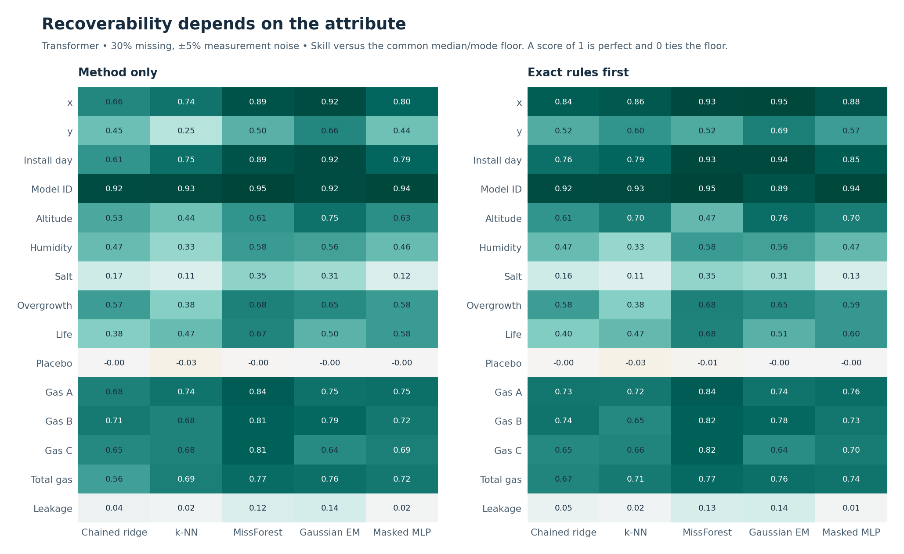

**Figure 1. Attribute skill at the anchor.** Compare the same rows across arms. The geometry, dates and gases are easier to recover than leakage or the placebo. The rules-first change differs by field and method.

## 7. Missing rate, measurement noise and age-dependent gaps

**Model-only numeric skill across the transformer scenarios**

| Scenario | Floor | Ridge | k-NN | Forest | EM | MLP |
| --- | --- | --- | --- | --- | --- | --- |
| mcar10-n00 | 0.000 | 0.689 | 0.614 | 0.793 | 0.748 | 0.695 |
| mcar10-n05 | 0.000 | 0.682 | 0.605 | 0.775 | 0.739 | 0.690 |
| mcar10-n10 | 0.000 | 0.676 | 0.580 | 0.759 | 0.729 | 0.678 |
| mcar20-n00 | 0.000 | 0.601 | 0.555 | 0.736 | 0.704 | 0.630 |
| mcar20-n05 | 0.000 | 0.597 | 0.546 | 0.720 | 0.692 | 0.625 |
| mcar20-n10 | 0.000 | 0.592 | 0.523 | 0.706 | 0.677 | 0.611 |
| mcar30-n00 | 0.000 | 0.500 | 0.492 | 0.670 | 0.653 | 0.570 |
| mcar30-n05 | 0.000 | 0.500 | 0.483 | 0.656 | 0.641 | 0.563 |
| mcar30-n10 | 0.000 | 0.495 | 0.463 | 0.640 | 0.625 | 0.550 |
| mcar50-n05 | 0.000 | 0.117 | 0.374 | 0.502 | 0.520 | 0.427 |
| mcar70-n05 | 0.000 | -0.339 | 0.240 | 0.302 | 0.345 | 0.288 |
| mar30-n05 | 0.000 | 0.524 | 0.473 | 0.652 | 0.622 | 0.548 |
| mcar30-n20 | 0.000 | 0.475 | 0.427 | 0.614 | 0.606 | 0.535 |
| mnar30-n05 | 0.000 | 0.492 | 0.487 | 0.663 | 0.642 | 0.569 |

**Why.** As independent masking grows, fewer useful inputs survive. The ±20% stress adds measurement error on the seven measured fields. MAR keeps x visible, changing which clues are available. Match the generator and split before interpreting the differences in the optional scenarios.

Chained ridge reaches −0.339 skill at 70% missingness, below the median floor. Its linear conditionals reuse earlier guesses as predictors. With few observed inputs, errors can propagate through the chain and produce large deviations. The saved runs show the collapse, but do not isolate the contribution of that feedback.

*Saved source — final/tables/macro_run_scores.csv.*

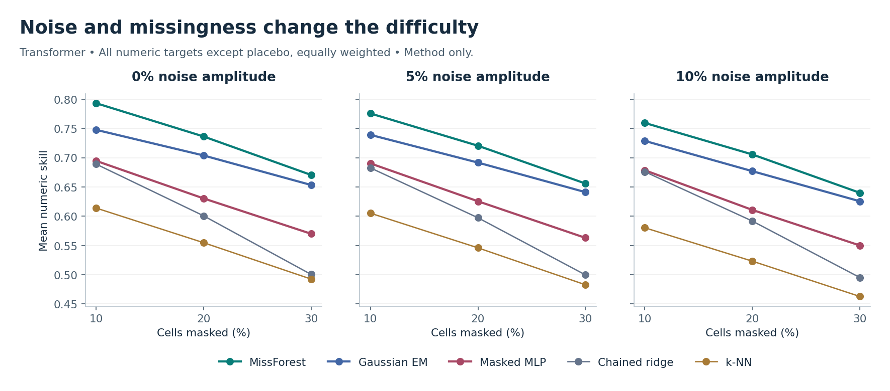

**Figure 2. The missing-rate and noise grid.** Slopes show how much skill changes as observations disappear within a noise setting. The chart uses the same weighting and domain-feature arm as the table.

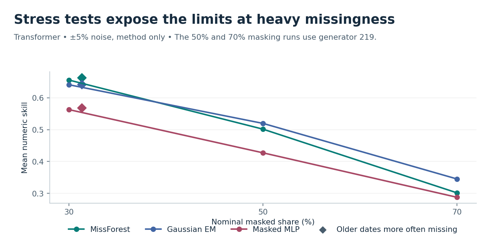

**Figure 3. Heavy independent missingness.** At 70% independent missingness, Gaussian EM leads the three primary methods. This scenario is distinct from 30% grouped missingness and does not use the later grouped MLP training variant.

**MAR and ±20% noise on matched generator and splits**

| Method | Anchor skill | MAR skill | 20% noise skill | Anchor / MAR / 20% within loose tolerance |
| --- | --- | --- | --- | --- |
| Median / mode | 0.000 | 0.000 | 0.000 | 32.1% / 33.6% / 31.7% |
| Chained ridge | 0.487 | 0.524 | 0.475 | 55.0% / 65.1% / 54.3% |
| k-NN | 0.490 | 0.473 | 0.427 | 53.2% / 54.2% / 50.2% |
| MissForest | 0.664 | 0.652 | 0.614 | 68.5% / 70.0% / 66.4% |
| Gaussian EM | 0.645 | 0.622 | 0.606 | 74.5% / 74.8% / 72.6% |
| Masked MLP | 0.565 | 0.548 | 0.535 | 59.3% / 60.5% / 58.6% |

**Why.** The MAR perturbation changes which rows are hidden and keeps x available; the 20% perturbation preserves the MCAR mask and changes only jitter amplitude. These are different mechanisms. The matching here removes variation from using a different generator.

At the matched anchor, MissForest leads on mean floor-relative skill (0.664 versus 0.645), while Gaussian EM has a larger mean share within loose field tolerance (74.5% versus 68.5%). For SAPN, the preferred method depends on whether the goal is to reduce relative error overall or to bring more predictions within the field limits.

*Saved source — final/tables/macro_run_scores.csv, seed 219, model only, domain features on.*

**MissForest installation-day audit, MCAR / MNAR**

| True age band | Masked share | MAE, days | Bias, days | Age-share change, pp |
| --- | --- | --- | --- | --- |
| Oldest | 29.6% / 54.5% | 39.3 / 27.6 | +30.3 / +16.7 | -0.24 / -0.02 |
| Older middle | 30.0% / 56.2% | 40.0 / 37.6 | -3.8 / -9.5 | +0.60 / -0.48 |
| Younger middle | 30.2% / 4.9% | 42.7 / 58.6 | +1.4 / -11.9 | -0.34 / +0.53 |
| Youngest | 30.4% / 5.2% | 30.8 / 40.0 | -18.2 / -33.5 | -0.02 / -0.03 |
| Older half | 29.8% / 55.4% | 39.5 / 32.7 | +12.8 / +3.2 | +0.36 / -0.50 |

**Why.** The hidden dates differ across scenarios. The median-floor MAE rises from 342.9 to 497.8 days. Relative skill increases even though the older-heavy masked population and the floor have changed. Positive date bias makes the asset appear younger.

*Saved source — final/tables/installation_age_summary.csv.*

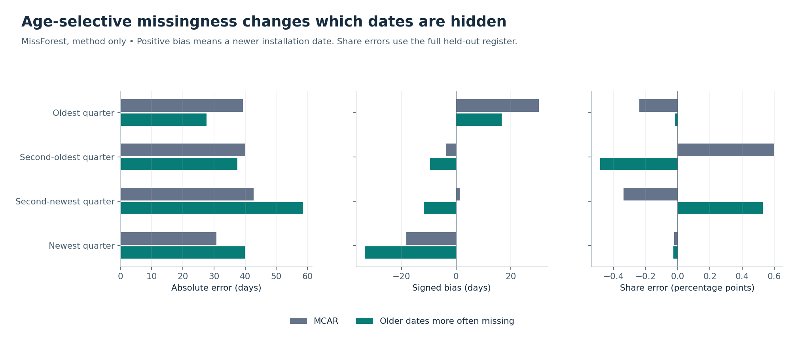

**Figure 4. Age-selective gaps and date bias.** Compare absolute date error and signed error before the completed register’s age shares. The bars represent fixed reference age bands for each generator seed.

## 8. Grouped gaps and structural errors

The grouped test holds the nominal 30% gap rate and ±5% jitter fixed. It hides the location block, gas block, environmental block, or installation-day/model-ID block together. Life, leakage and placebo keep their own draws. This simulates structured missingness, where fields are absent together and the overall missing rate can hide the loss of linked inputs (Mitra et al., 2023). The structural test preserves the independent anchor mask and adds ±60-day shifts to about 5% of dates and valid code swaps to about 2% of model IDs. Both tests preserve recorded values.

**Mean numeric skill, model only**

| Method | Scattered | Grouped | Structural errors |
| --- | --- | --- | --- |
| Median / mode | 0.000 | 0.000 | 0.000 |
| Chained ridge | 0.500 | 0.249 | 0.496 |
| k-NN | 0.483 | 0.370 | 0.480 |
| MissForest | 0.656 | 0.264 | 0.650 |
| Gaussian EM | 0.641 | 0.435 | 0.629 |
| Masked MLP | 0.563 | 0.375 | 0.559 |
| MLP with matched training masks | — | 0.453 | — |

**Why.** Grouped gaps remove the helper fields together. Under grouped masking MissForest humidity skill is 0.06 and salt is -0.03. y and altitude fall below their medians when both the geometric inputs and their exact formula are unavailable.

*Saved source — failure-audit/tables/mean_numeric_skill_by_pair.csv; anchor-stress/tables/cells.csv.*

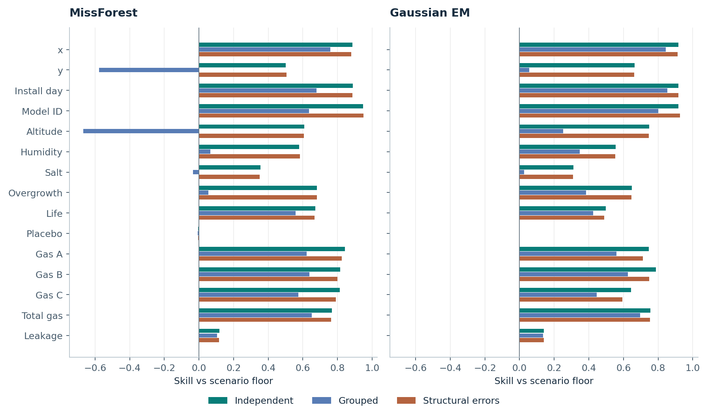

**Figure 5. Where recovery breaks.** The grouped bars fall most for the location and environmental fields. The structural-error bars largely follow the scattered average, which is why a row-level check is needed.

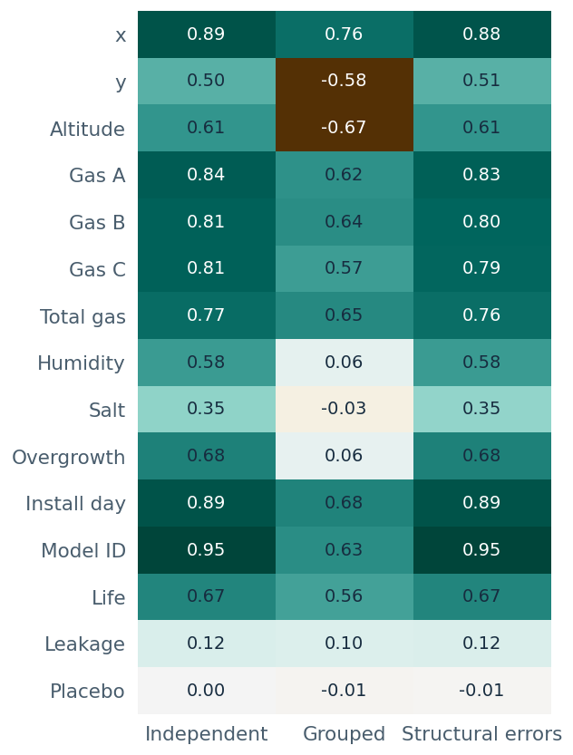

**Figure 6. MissForest field results in the stress tests.** The heat map complements the bars. Compare the sharp drop in the grouped column against the small mean change with structural errors.

**MissForest on the same hidden gas cells with a wrong visible clue**

| Target | Hidden cells | Anchor MAE | Structural-error MAE |
| --- | --- | --- | --- |
| Gas A | 31 | 178.2 | 538.7 |
| Gas B | 29 | 245.9 | 567.4 |
| Gas C | 31 | 220.8 | 744.7 |

**Why.** The full-test average dilutes the effect because relatively few rows have a corrupt clue. This matched split illustrates how a wrong recorded date or model code can distort multiple gas fills.

*Saved source — failure-audit/tables/structural_error_cohort_219_617.csv, generator 219 and split 617.*

**Matched MLP training masks**

| Evaluation | Independent remasking | Grouped remasking | Pair wins |
| --- | --- | --- | --- |
| Grouped test, model only | 0.375 | 0.453 | 9/9 |
| Grouped test, rules first | 0.386 | 0.453 | 9/9 |
| Grouped tuning blocks, model only | 0.371 | 0.454 | 9/9 |

**Why.** Extra group-wise masking trains on the same kind of absent inputs the model sees at test. This correction was made after inspecting the grouped test results. The retrospective check on the original tuning blocks supports the comparison without a new hyperparameter search. The grouped MLP also beat Gaussian EM in 9/9 paired test comparisons.

*Saved source — failure-audit/tables/mlp_remask_comparison.csv, grouped_mlp_vs_em.csv; final-review/grouped_mlp_tuning_by_pair.csv.*

**Helper-field diagnostics for MissForest**

| Target | Alone MAE | Scattered MAE | Grouped MAE |
| --- | --- | --- | --- |
| Installation day | 10.03 | 38.15 | 110.71 |
| y | 4.57 | 12.58 | 40.11 |
| Altitude | 4.99 | 12.85 | 54.65 |
| Humidity | 0.03 | 0.07 | 0.16 |
| Overgrowth | 0.02 | 0.10 | 0.28 |

**Why.** The alone scenario uses the same hidden target cells as scattered gaps and leaves the other fields visible. The grouped scenario also hides the helpers. The alone comparison changes the fitted model and is an information-rich reference rather than a guaranteed upper bound on skill.

*Saved source — anchor-diagnostics/tables/masking_summary.csv and paired_masking.csv.*

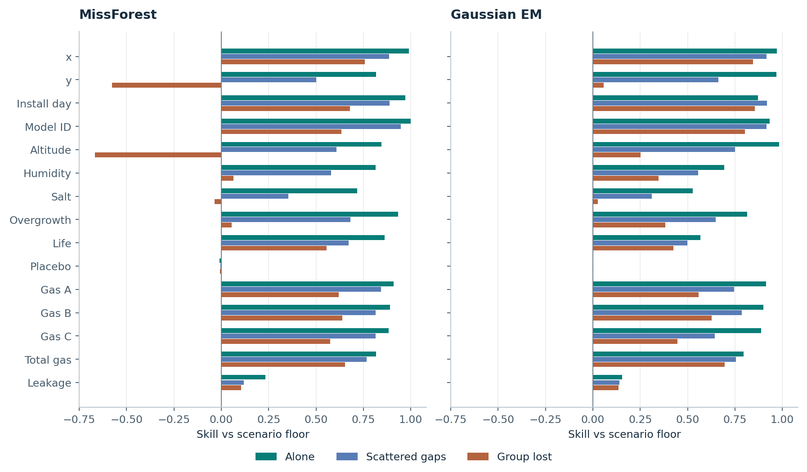

**Figure 7. Availability of helper fields.** The alone, scattered and grouped bars isolate availability. Gaussian EM’s date result illustrates that refitting under different masks can change the outcome even with more observed inputs.

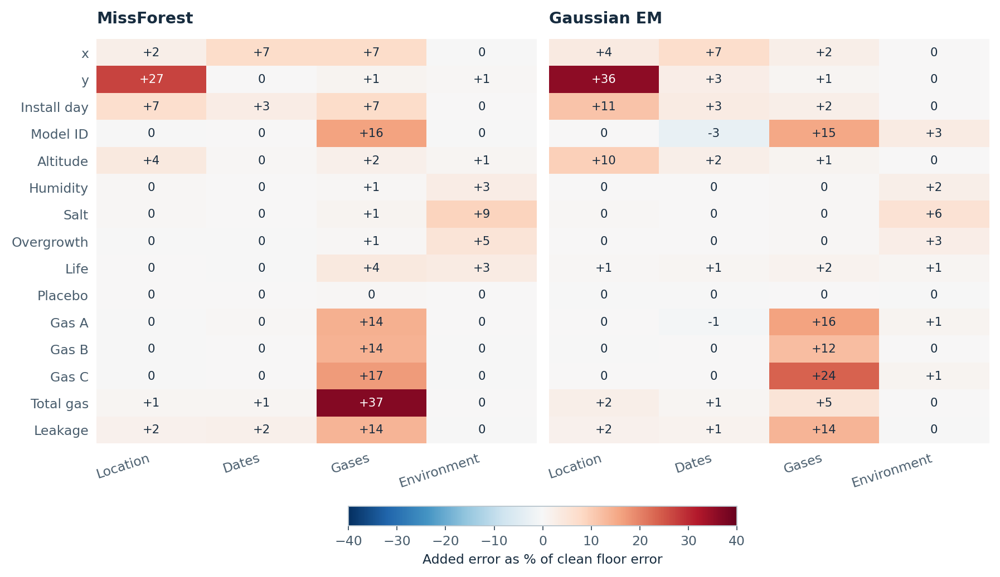

**Figure 8. Sensitivity to which inputs are noisy.** Each family is compared with the clean anchor on matched gaps. Warm cells show increases in error as a share of clean floor error. This design combines changes to recorded predictors and training values.

## 9. Confidence, calibration and auto-fill

**Worst supported anchor pattern for MissForest**

| Intervals | Observed coverage |
| --- | --- |
| Raw | 26.4% |
| Pooled | 65.3% |
| Pattern-aware | 73.2% |

**Why.** Pooling mixes easy and difficult missingness patterns. Matching coverage to the evidence available improves the weakest result, which remains below 90%. Each column reports its own minimum over the supported pattern-and-run rows.

*Saved source — final/tables/patterns.csv, model only, key+burden, domain features on.*

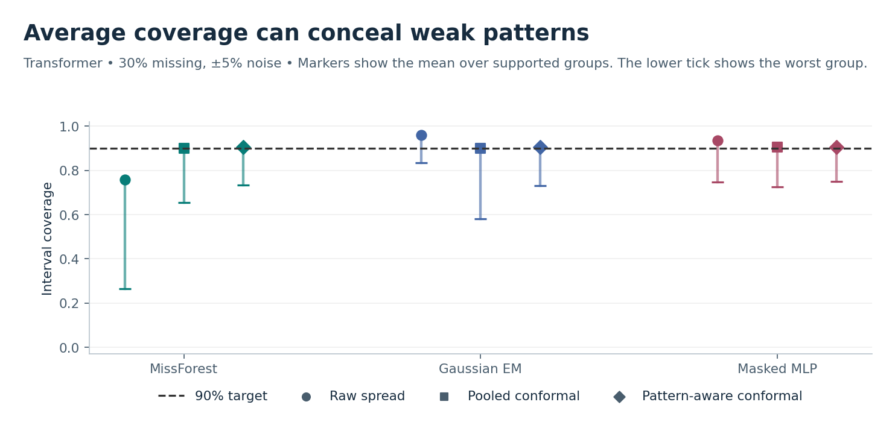

**Figure 9. Coverage by missing pattern.** A reasonable overall coverage value can coexist with weak groups. Read the pattern minimum alongside raw, pooled and pattern-aware coverage.

**Model ID probability calibration at the anchor, model only**

| Method | Raw log loss | Scaled log loss | Raw ECE | Scaled ECE |
| --- | --- | --- | --- | --- |
| MissForest | 0.2862 | 0.1937 | 0.0303 | 0.0281 |
| Gaussian EM | 0.1221 | 0.1224 | 0.0137 | 0.0139 |
| Masked MLP | 0.1058 | 0.1040 | 0.0195 | 0.0161 |

**Why.** Temperature scaling fits a single parameter by minimising log loss (Guo et al., 2017). Expected calibration error (ECE) is binned and can move differently. MissForest’s ECE fell from 0.0303 to 0.0281 in the model-only arm, but rose from 0.0269 to 0.0312 in the rules-first arm. Log loss fell in both arms.

*Saved source — final/tables/cells.csv, Model ID. The table uses model-only rows; the ECE comparison uses both arms.*

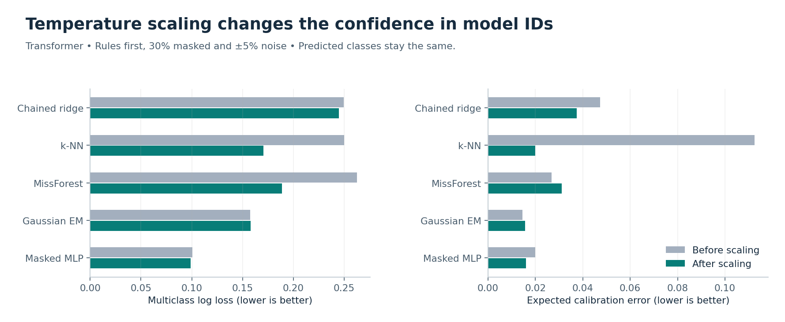

**Figure 10. Temperature scaling and probability error, rules first.** This panel uses the rules-first arm. The preceding table uses the model-only arm.

**Grouped gaps and the confidence gate, rules first**

| Method and field | Eligible | Precision | Coverage | Abstain |
| --- | --- | --- | --- | --- |
| MissForest · Gas A | 21.1% | 93.98% | 87.9% | 48.8% |
| MissForest · Model ID | 0.0% | — | — | 29.0% |
| Gaussian EM · Model ID | 70.6% | 99.97% | — | 21.2% |
| MissForest · y | 0.0% | — | 88.5% | 100.0% |
| Gaussian EM · y | 0.0% | — | 88.4% | 100.0% |
| MissForest · Altitude | 0.0% | — | 87.0% | 100.0% |
| Gaussian EM · Altitude | 0.0% | — | 89.1% | 100.0% |
| MissForest · Humidity | 0.0% | — | 90.9% | 100.0% |
| Gaussian EM · Humidity | 0.0% | — | 91.0% | 100.0% |
| MissForest · Salt | 0.0% | — | 91.2% | 100.0% |
| Gaussian EM · Salt | 0.0% | — | 92.4% | 100.0% |
| MissForest · Overgrowth | 0.0% | — | 91.0% | 100.0% |
| Gaussian EM · Overgrowth | 0.0% | — | 90.6% | 100.0% |

**Why.** Wide bands stop low-evidence numeric fills even when coverage is near target. MissForest Gas A breaches the 95% precision target and falls below 90% coverage. Require independent pattern validation. Under these grouped gaps Gaussian EM assigns a much larger high-probability class subset than MissForest.

*Saved source — failure-audit/tables/routing.csv.*

**Figure 11. Eligibility versus observed precision.** Read the eligible share and precision together. In the primary methods, every eligible y and altitude fill came from the exact rule. All eligible x fills for Gaussian EM and the MLP were also exact.

**Model-based x fills breach the precision target.** In the rules-first MissForest arm, only 112 of 151 eligible model-based x fills were correct (74.2%), below the 95% target. The 2,584 exact-rule fills account for most of the eligible set and lift combined precision to 98.6%. Keep model-based x fills in review until independent pattern-level validation meets the target.

*Saved source — final-review/rule_vs_model_eligibility.csv; final/tables/attribute_guidance.csv.*

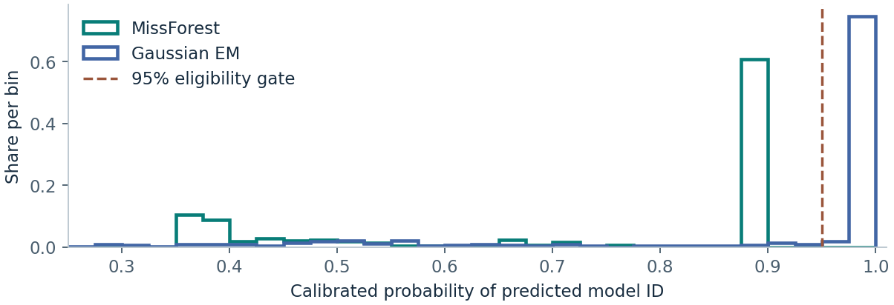

**Figure 12. Top-class probabilities on the representative grouped split.** On the exported 219/617 split, MissForest’s maximum was 90.0%. Gaussian EM crossed the 95% gate on 447 of 584 gaps. Averaging trees can damp extreme probabilities, but this check cannot isolate the cause of the observed difference. See Niculescu-Mizil and Caruana (2005).

## 10. Distribution, downstream life, consistency and exact rules

**Point-fill distribution metrics, rules first**

| Method | Mean hidden W₁ / train scale | Median spread ratio | Energy distance | Correlation MAE |
| --- | --- | --- | --- | --- |
| Median / mode | 0.746 | 0.00 | 0.066 | 0.075 |
| Chained ridge | 0.215 | 0.97 | 0.013 | 0.021 |
| k-NN | 0.257 | 0.80 | 0.017 | 0.017 |
| MissForest | 0.136 | 0.95 | 0.010 | 0.016 |
| Gaussian EM | 0.165 | 0.92 | 0.011 | 0.013 |
| Masked MLP | 0.206 | 0.89 | 0.014 | 0.015 |

**Why.** The Wasserstein values use one point per gap. Conditional point fills can narrow distributions and lose tail cases, consistent with van Buuren’s discussion of single deterministic imputation (2018, Section 1.3). The spread ratio and record-level association check show different effects.

*Saved source — final/tables/distribution.csv and tables.csv.*

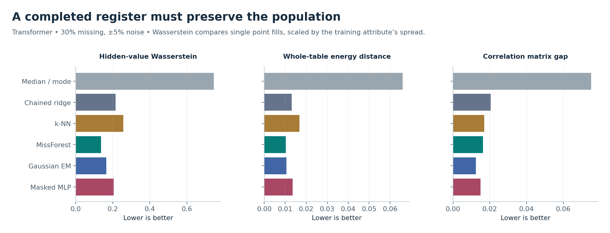

**Figure 13. Distribution preservation under point filling.** Compare hidden and completed distributions and the spread ratio. Completed tables include the preserved observations, which can make large changes among fills look smaller overall.

**Downstream life with MissForest candidate features**

| Inputs | MAE | Spearman ρ | Lowest-life decile recall |
| --- | --- | --- | --- |
| Clean train / clean test | 19.5 | 0.997 | 97.5% |
| Filled train / clean test | 25.0 | 0.995 | 96.5% |
| Clean train / filled test | 61.2 | 0.933 | 86.9% |
| Filled train / filled test | 63.6 | 0.933 | 86.7% |

**Why.** Most of the damage appears when the downstream model predicts on filled inputs. Against the clean MAE of 19.5, filling training inputs alone raises it to 25.0, while filling test inputs alone raises it to 61.2. The training labels and model specification are fixed. For this benchmark, prioritise validation of predictions made on filled records.

*Saved source — final/tables/downstream.csv, rules first, transformer anchor.*

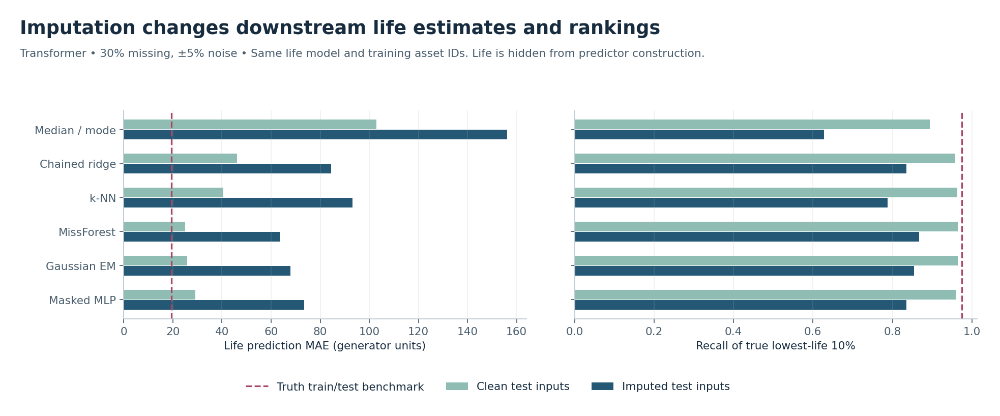

**Figure 14. Downstream life and ranking.** Compare clean and filled feature configurations before interpreting the lowest-life ranking. Synthetic life remains an evaluation outcome.

**Record consistency — Zero noise**

| Method | Arm | Altitude loose / exact | Total gas loose / exact | Overgrowth loose / exact |
| --- | --- | --- | --- | --- |
| MissForest | Model only | 57.3% / 1.5% | 100.0% / 0.0% | 64.4% / 18.6% |
| MissForest | Rules first | 81.8% / 67.3% | 100.0% / 53.9% | 88.8% / 72.3% |
| Gaussian EM | Model only | 99.1% / 0.1% | 98.8% / 0.0% | 59.4% / 23.6% |
| Gaussian EM | Rules first | 99.9% / 67.3% | 99.0% / 53.9% | 85.1% / 73.0% |
| Masked MLP | Model only | 48.7% / 0.1% | 99.9% / 0.0% | 42.6% / 19.0% |
| Masked MLP | Rules first | 78.0% / 67.3% | 99.9% / 53.9% | 76.2% / 69.8% |

**Why.** Rates refer to records with a gap in a formula term. With clean inputs the exact rules can recover eligible identities; several missing terms can leave an identity underdetermined.

*Saved source — final/tables/consistency.csv.*

**Record consistency — ±5% measurement noise**

| Method | Arm | Altitude loose / exact | Total gas loose / exact | Overgrowth loose / exact |
| --- | --- | --- | --- | --- |
| MissForest | Model only | 57.0% / 1.5% | 99.9% / 0.0% | 62.6% / 18.3% |
| MissForest | Rules first | 81.8% / 67.3% | 99.9% / 0.0% | 62.8% / 18.4% |
| Gaussian EM | Model only | 99.1% / 0.1% | 96.4% / 0.0% | 59.1% / 23.6% |
| Gaussian EM | Rules first | 99.9% / 67.3% | 96.3% / 0.0% | 59.2% / 23.6% |
| Masked MLP | Model only | 48.2% / 0.1% | 99.6% / 0.0% | 42.5% / 18.4% |
| Masked MLP | Rules first | 77.1% / 67.3% | 99.6% / 0.0% | 43.9% / 19.1% |

**Why.** With jitter, exact gas and environmental identities are disabled. Altitude remains deterministic if its two inputs are present. An accurate single-cell fill may still violate a formula when multiple fields are filled.

*Saved source — final/tables/consistency.csv.*

On rows with all terms observed at the noisy anchor, loose-tolerance agreement averaged 100.0% for altitude, 100.0% for total gas and 90.6% for overgrowth. That 90.6% is the observed-data reference for overgrowth. A gap-filling workflow that preserves observations cannot repair those existing inconsistencies. Agreement on the separate subset of filled rows can be higher or lower.

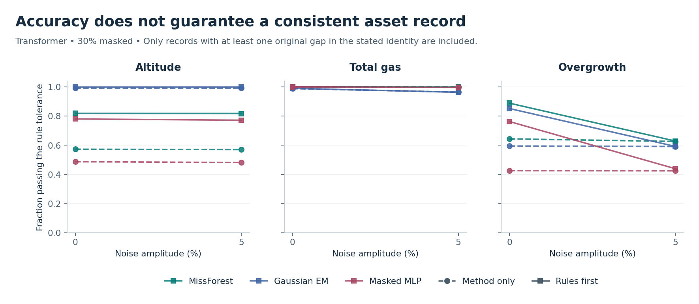

**Figure 15. Formula consistency at zero and nonzero noise.** Rules-first performance depends on which identities are safe to apply and which operands are present. The exact and tolerance-level results above distinguish exact recovery from approximate agreement.

**MissForest rule contribution at the anchor**

| Slice | Direct contribution | Remaining contribution | Remaining MAE, model → rules |
| --- | --- | --- | --- |
| All numeric fields | +0.022 | -0.021 | — |
| Altitude | +0.094 | -0.229 | 19.1 → 33.7 (2,813 gaps) |

**Why.** Exact replacements help, but error on remaining cells offsets most of the gain. None of the remaining altitude test rows had a raw input changed by the rules. The deterioration lies in the fitted pipeline. **Observed; cause not established.**

*Saved source — final-review/non_rule_errors.csv; final/tables/rule_effects.csv.*

**Geometry eligibility provenance, MissForest rules-first**

| Field | Eligible exact fills | Eligible model fills | Correct model fills |
| --- | --- | --- | --- |
| x | 2,584 | 151 | 112 |
| y | 2,714 | 0 | 0 |
| Altitude | 2,645 | 0 | 0 |

**Why.** Exact geometry fills have a different provenance from a model estimate. The two types should be counted separately when assessing the gate.

*Saved source — final-review/rule_vs_model_eligibility.csv.*

**Ablation of decay-corrected gases**

| Method | Without correction | With correction | Paired mean change |
| --- | --- | --- | --- |
| MissForest | 0.657 | 0.656 | -0.001 |
| Gaussian EM | 0.671 | 0.641 | -0.030 |
| Masked MLP | 0.566 | 0.563 | -0.003 |

**Why.** Feature construction can change the ranking. A flexible forest can already use the original signals, and the correction can change the representation in ways that affect each model differently.

*Saved source — final/tables/macro_run_scores.csv, same anchor and matched pairs.*

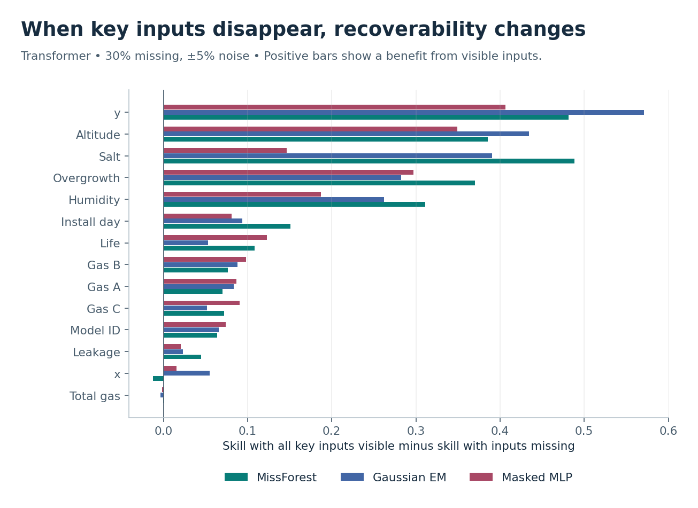

**Figure 16. What happens when related inputs are unavailable.** The contrast is conditional on which helper fields are actually visible. Use it alongside the deliberately grouped-gap experiment.

## 11. Screening values that are already recorded

Hide each recorded installation day or model ID in turn and predict it from the remaining measurements. Compare a recorded date with a calibrated numeric band. Compare a recorded class with the calibrated threshold on its predicted probability. Calibration uses verified clean examples. Match by key-input visibility and gap burden when support permits. Keep the recorded value until a flag is checked against an independent source.

**Synthetic screening at the nominal 5% setting**

| Target | Method | Caught / injected | Recall | False-alarm rate | Flag precision |
| --- | --- | --- | --- | --- | --- |
| Installation day | MissForest | 267 / 638 | 41.8% | 4.9% | 31.2% |
| Installation day | Gaussian EM | 320 / 638 | 50.2% | 5.4% | 33.2% |
| Model ID | MissForest | 225 / 234 | 96.2% | 5.1% | 26.3% |
| Model ID | Gaussian EM | 226 / 234 | 96.6% | 5.6% | 24.6% |

**Why.** Only a small fraction of records is wrong. A modest false-alarm rate applied to the much larger clean group can produce more false flags than true flags. Model codes are easier to detect here than plausible dates.

*Saved source — failure-audit/tables/screening_operating_points.csv.*

**Suggested code-review pilot setting.** Gaussian EM at nominal 1% caught 73.5% of swapped IDs with 68.0% precision and 0.7% observed false alarms. Use the flags for review after confirming access to verified clean reference values.

**Date-shift replay at the nominal 5% setting**

| Method | Injected shift | Caught / candidates | Recall | Median clean band half-width |
| --- | --- | --- | --- | --- |
| MissForest | 60 days | 267 / 638 | 41.8% | 104 days |
| MissForest | 120 days | 345 / 638 | 54.1% | 104 days |
| MissForest | 180 days | 396 / 638 | 62.1% | 104 days |
| Gaussian EM | 60 days | 320 / 638 | 50.2% | 64 days |
| Gaussian EM | 120 days | 517 / 638 | 81.0% | 64 days |
| Gaussian EM | 180 days | 574 / 638 | 90.0% | 64 days |

**Why.** Sixty days can fit inside the calibrated band. The larger shifts were replayed on the same affected candidates using saved predictions and cutoffs, varying only the recorded date. The replay gives conditional sensitivity, rather than a new fit or a population-wide estimate.

*Saved source — final-review/date_shift_replay.csv.*

## 12. Overhead transfer and earlier SAPN-style pilot

The transfer withholds entire feeders and excludes feeder and segment IDs as predictors. The prepared overhead pairs have a separate noise convention. The analysis caps imputed installation years at the 2014 snapshot, rounds to integer years before scoring and uses an inclusive age-50 threshold. Observed years are preserved.

**Overhead transfer at 30% supplied noise**

| Field | Best method by defined skill | Best skill | MissForest metric |
| --- | --- | --- | --- |
| Corrosion zone | MissForest | 0.453 | Skill 0.453 |
| Covering | — | — | Macro-F1 0.523 |
| Distance to sea km | MissForest | 0.090 | Skill 0.090 |
| Installation year | Median / mode | 0.000 | Skill -0.038 |
| Length km | Median / mode | 0.000 | Skill -0.015 |
| Location group | Median / mode | 0.000 | Skill -0.088 |
| Material | Median / mode | 0.000 | Skill -0.052 |
| Voltage category | Median / mode | 0.000 | Skill -0.008 |

**Why.** Only 1 of 7 fields with defined skill reached 0.10. Covering has a near-perfect modal floor and is better read through macro-F1. The weak material result is consistent with the overwhelming modal steel class.

*Saved source — final/tables/cells.csv, overhead20-n30.*

**Overhead numeric skill across supplied noise levels**

| Scenario | Floor | Ridge | k-NN | Forest | EM | MLP |
| --- | --- | --- | --- | --- | --- | --- |
| overhead20-n00 | 0.000 | 0.096 | 0.047 | 0.113 | 0.116 | 0.125 |
| overhead20-n10 | 0.000 | 0.055 | 0.004 | 0.069 | 0.070 | 0.078 |
| overhead20-n30 | 0.000 | 0.013 | -0.028 | 0.013 | 0.015 | 0.013 |
| overhead20-n50 | 0.000 | -0.013 | -0.054 | -0.023 | -0.012 | -0.013 |

**Why.** Group holdout removes direct feeder memorisation. Stable aggregate skill may still conceal year error or distortion in the age tail.

*Saved source — final/tables/macro_run_scores.csv.*

The filled share aged 50 or older moved by +0.89 percentage points for MissForest at 30% supplied noise.

### Subteam A Phase 1 pilot and age-distribution follow-up

On one clean synthetic overhead population, Phase 1 hid 30% of material and installation-year values independently. The table averages five split/mask seeds. The follow-up retained the same point fills and estimated the share aged 50 or older by adding the probabilities for hidden years to the count from observed years.

**Subteam A Phase 1 results, clean predictors**

| Method | Material log loss | Installation-year MAE | Age 50+ share error, point fills | Age 50+ share error, probabilities |
| --- | --- | --- | --- | --- |
| Global floor | 0.750 | 10.84 years | +12.56 pp | +0.34 pp |
| Conditional baseline | 0.697 | 10.37 years | +9.00 pp | +0.27 pp |

**Why.** The conditional baseline improves both cell-level metrics, yet its single year fills overstate the share aged 50 or older by 9.00 percentage points. Using year probabilities brings that error down to +0.27 points without changing individual fills. This clean MCAR comparison supports using distributions for population summaries, rather than claiming that conditioning alone caused the gain.

*Saved source — Subteam A pilot, `v3_phase1_age50_label_20261024/cell_metrics.csv` and `population_metrics.csv`. Expected shares use the clean rows in `v3_age_distribution_checked_paired_20261025/population_age_metrics.csv`.*

### Context from Subteam C’s overhead study

Subteam C used feeder ID as a predictor, so its saved study answers a different question from the feeder-held-out transfer above.

**Subteam C context, installation year at zero added noise**

| Method | MAE, years | Skill vs pilot median |
| --- | --- | --- |
| Median | 10.39 | 0.000 |
| Random Forest | 10.88 | -0.047 |
| IterativeImputer | 10.57 | -0.018 |
| CatBoost | 10.63 | -0.023 |

**Why.** The near-floor year result provides a useful comparison for the stricter feeder holdout and the separate age-share check.

*Saved source — Subteam C overhead study, run 20261107-015341, numeric_scores.csv.*

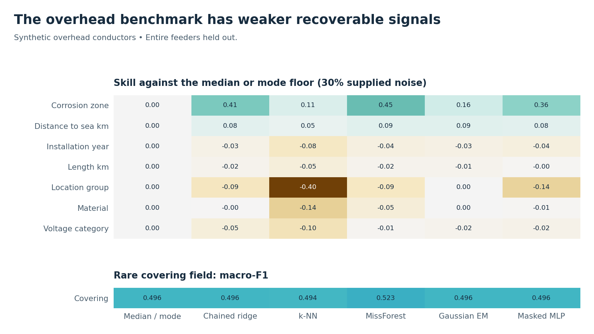

**Figure 17. Feeder-held-out overhead transfer.** Check each field separately. Covering is plotted with macro-F1, while other displayed results use the stated floor-relative metric.

## 13. Robustness, tuning, verification and targeted checks

**Break-rate sensitivity at the anchor**

| Skill cutoff | Required within loose tolerance | Fail skill | Fail tolerance | Fail either / evaluated |
| --- | --- | --- | --- | --- |
| 0.05 | 40% | 0 | 36 | 36 / 126 |
| 0.05 | 50% | 0 | 44 | 44 / 126 |
| 0.05 | 60% | 0 | 50 | 50 / 126 |
| 0.10 | 40% | 1 | 36 | 37 / 126 |
| 0.10 | 50% | 1 | 44 | 45 / 126 |
| 0.10 | 60% | 1 | 50 | 50 / 126 |
| 0.20 | 40% | 9 | 36 | 45 / 126 |
| 0.20 | 50% | 9 | 44 | 53 / 126 |
| 0.20 | 60% | 9 | 50 | 54 / 126 |

**Why.** Separating the criteria shows whether the skill cutoff or the tolerance requirement is driving the break label.

*Saved source — final/tables/break_sensitivity.csv.*

**Life gate sensitivity, rules first**

| Method | Within ±100 | Eligible ±100 | Precision ±100 | Lowest pair ±100 | Within ±500 |
| --- | --- | --- | --- | --- | --- |
| MissForest | 71.0% | 20.7% | 96.8% | 94.3% | 98.4% |
| Gaussian EM | 46.1% | 0.0% | — | — | 97.8% |
| Masked MLP | 60.2% | 9.1% | 92.4% | 66.7% | 98.4% |

**Why.** The absolute limits keep the synthetic offset from making acceptance too generous. The MLP’s lowest precision is sensitive to a small number of eligible fills.

*Saved source — final/tables/life_tolerance_sensitivity.csv.*

The MLP’s lowest tight-tolerance life precision was 12/18 on generator 220, split 617. The teaching SVM selected C = 100 with test macro-F1 0.949. This was the largest searched C, so the optimum beyond the grid is unknown.

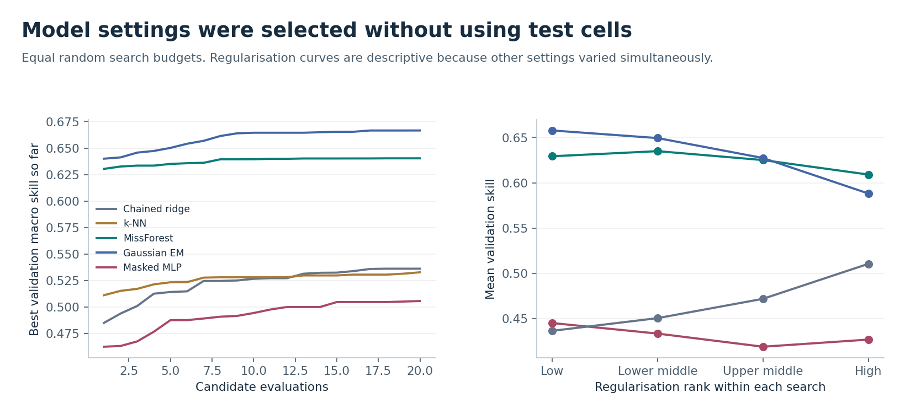

**Figure 18. Matched tuning budgets and selected settings.** The search compares model settings on tuning blocks. The plot shows search variability and cost at the original anchor.

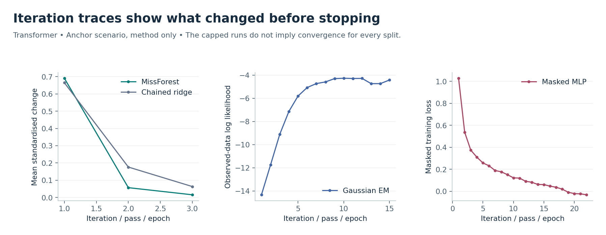

**Figure 19. Iteration and training traces.** The traces show what changed before the fixed or early stopping points. The runs do not establish convergence for every split.

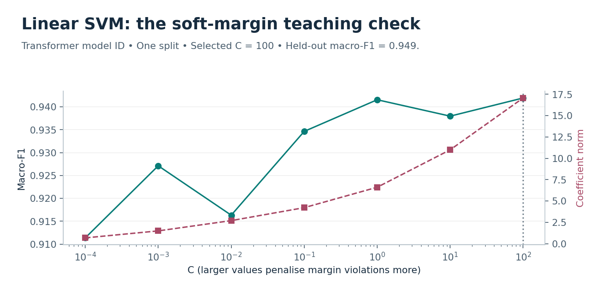

**Figure 20. Soft-margin SVM teaching check.** The vertical line marks the validation-selected C = 100, at the upper search boundary. This teaching exercise is separate from the main imputer ranking.

**Archived results reproduced by the package verifier**

| Run | Tasks | Exports | Hidden cells | Tuning trials | Screening rows |
| --- | --- | --- | --- | --- | --- |
| final | 123 | 192 | 1,495,404 | 900 | — |
| anchor-stress | 18 | 24 | 216,780 | 0 | — |
| anchor-diagnostics | 171 | 57 | 136,005 | 0 | — |
| failure-audit | 9 | 2 | 17,996 | 0 | 50,440 |

**Why.** The verifier recomputes scores from the original measured values, candidate ledgers and truth. It checks preserved observations, partitions, tolerances and decision flags. The separate raw-task check reproduced the full-run counts without renderer-generated CSVs.

*Saved source — each archived run verification.json; packaging verification.*

The test suite passed all 32 tests. This includes source reproducibility, block isolation, rule safety, scenario masking, preservation of observations, uncertainty, and screening thresholds. A fresh smoke run verified four task outputs using task JSON and ledgers alone.

## 14. Limitations

The transformer results use one generator family with designed masks and errors. Spatial installation order and exact identities can make recovery easier than on live SAPN records, where both imputation and screening still need validation. The overhead transfer is synthetic and uses a different noise convention. The Phase 1 age-share result describes clean MCAR on one synthetic population. The feeder-aware Subteam C study uses a separate protocol.

Main settings were tuned at 30% MCAR. The grouped MLP correction is retrospective. The original tuning blocks support it, while a prospective validation remains open. The crossed design has few independent seeds. Coarse calibration can leave specific patterns below target, and screening requires verified clean examples.

For MissForest’s residual altitude loss, **observed; cause not established**. The model-ID probability plot describes one split, and its shape alone cannot explain the scores. Screening covers the injected codes and date shifts tested here.

## 15. Findings and conclusions

### When can missing records be recovered?

Recovery is strongest when measured helper fields survive and the evaluation matches the conditions expected in use. The scattered-gap anchor supports selective recovery for fields such as model ID and gas values. High average skill can coexist with low confidence for a particular field or pattern. Exact rules should be audited separately from model-based recovery so their provenance and reliability are visible.

**Three practical causes of failure.** First, related fields can disappear together, eliminating the inputs needed for formulas and learned relationships. Second, weakly informative or noisy inputs can leave a prediction close to the median or produce a wide interval even when a method beats the baseline. Third, a wrong value that remains visible can propagate into multiple fills on the same row. The structural-error cohort shows why checking recorded values and filling missing values are separate tasks.

**Main inferences**

1. MissForest led on scattered-gap skill, while Gaussian EM placed more fills within loose tolerance on the matched anchor.
2. Grouped gaps changed the ranking. The MLP led after its training masks were matched to the grouped design.
3. Validate eligibility by field and missing pattern. Pooled precision can hide failures such as model-based x.
4. Validate downstream predictions on filled inputs. In this study, filling test inputs did more damage than filling training inputs.
5. For population age shares, aggregate year probabilities. In Phase 1, single year fills overstated the older share.
6. Screen recorded values separately and send flags to review. Verify them against an independent source.

### Method guidance and a SAPN pilot

**Which method to use under each kind of evidence**

| Situation | Method or policy | Reason |
| --- | --- | --- |
| Scattered transformer gaps with measured clues | Benchmark MissForest and Gaussian EM | The leader changes with the feature set; compare on paired blocks and field error. |
| Related fields go missing together | Benchmark a grouped-trained MLP and Gaussian EM | The grouped MLP led the matched test pairs; Gaussian EM was competitive. Route wide bands to abstention. |
| Exact geometry identity has valid inputs | Use the rule and label its provenance | Exact fills and model-generated fills have different error guarantees in this synthetic design. |
| Model code looks suspicious | Gaussian EM, nominal 1% pilot screen | Prioritise source verification and retain the recorded value until checked. |
| Overhead installation age and weak-signal fields | Use the floor as a comparison; route to review | Feeder-held-out evidence is weak and the acceptable year error is provisional. |

**Why.** The safest workflow depends on the field, the missingness pattern and the intended use. Apply separate checks for point accuracy, pattern coverage and false alarms.

*Saved source — final/tables/cells.csv and macro_run_scores.csv; failure-audit/tables/mean_numeric_skill_by_pair.csv and screening_operating_points.csv.*

**Field verdicts at the rules-first anchor**

| Field | Point leader | Skill | Benchmark candidate | Eligible | Precision | Suggested treatment |
| --- | --- | --- | --- | --- | --- | --- |
| x | Gaussian EM | 0.945 | Exact rule + MissForest | 51.7% | 98.6% combined | Use the exact rule with valid inputs. Model fills had 74.2% precision. Review pending pattern validation. |
| y | Gaussian EM | 0.692 | Exact rule | 50.1% | 100.0% | Use the exact rule with valid inputs. Review the rest. |
| Installation day | Gaussian EM | 0.935 | MissForest | 23.8% | 98.3% | Auto-fill confident cases and review the rest |
| Model ID | MissForest | 0.950 | Masked MLP | 86.5% | 99.7% | Auto-fill confident cases and review the rest |
| Altitude | Gaussian EM | 0.764 | Exact rule | 48.5% | 100.0% | Use the exact rule with valid inputs. Review the rest. |
| Humidity | MissForest | 0.581 | MissForest | 1.1% | 96.7% | Review. Very few cases qualify. |
| Salt | MissForest | 0.349 | — | — | — | Review and leave gaps when supporting inputs are missing |
| Overgrowth | MissForest | 0.684 | MissForest | 3.8% | 95.0% | Review. Very few cases qualify. |
| Life | MissForest | 0.679 | MissForest | 20.7% | 96.8% | Use the ±100 unit gate for eligible cases |
| Placebo | — | — | — | — | — | Leave blank |
| Gas A | MissForest | 0.842 | MissForest | 79.9% | 97.9% | Auto-fill confident cases and review the rest |
| Gas B | MissForest | 0.816 | Gaussian EM | 85.5% | 97.8% | Auto-fill confident cases and review the rest |
| Gas C | MissForest | 0.817 | MissForest | 83.3% | 98.2% | Auto-fill confident cases and review the rest |
| Total gas | MissForest | 0.775 | — | — | — | Review and leave gaps when supporting inputs are missing |
| Leakage | Gaussian EM | 0.141 | — | — | — | Review and leave gaps when supporting inputs are missing |

**Why.** These are retrospective field-level shares. All eligible y and altitude fills came from the exact rule. The combined x figure pools exact-rule and MissForest fills and cannot establish the reliability of model-based x. Humidity and overgrowth go to review because few cases qualify.

*Saved source — final/tables/attribute_guidance.csv; final-review/rule_vs_model_eligibility.csv.*

**Recommendations.** Record which fields are missing together. Benchmark candidate methods on verified records with feeder or location holdouts. Route wide intervals, unsupported patterns and unvalidated tolerances to review. Audit high-impact observed fields separately. Track false alarms, precision and review capacity by field before widening deployment.

**Questions for SAPN.** Which assets and fields are in scope? How often do individual fields and whole sections go missing? Which recording errors recur and what source can verify a flagged value? What tolerances apply by field and use case, including whether ±5 years is acceptable for overhead installation year?

### Predictions versus results

**What changed after testing**

| Earlier prediction | Outcome | Saved evidence |
| --- | --- | --- |
| MissForest leads with decay-corrected gases | Supported for the feature-enabled anchor | MissForest 0.656 versus Gaussian EM 0.641. Without the correction, Gaussian EM 0.671 versus MissForest 0.657. |
| Gaussian EM is strong on sums and equipment model structure | Partly supported | With rules first it led on x, y, installation day and altitude. Its total-gas skill was 0.756 versus 0.775 for MissForest. |
| The masked MLP holds up best at high independent missingness | Rejected in the 70% MCAR test | Gaussian EM 0.345 versus MLP 0.288. |
| Matching training masks helps the grouped MLP | Supported in retrospective follow-up | Grouped MLP 0.453 versus Gaussian EM 0.435. |
| Decay-corrected gas features improve the leader | Rejected for anchor MissForest | With minus without correction -0.001. |
| Calibration needs pattern information | Supported | Worst MissForest coverage moved from 26.4% raw to 73.2% pattern-aware. |
| Gaussian EM starts with stronger uncertainty coverage | Supported on average | Raw supported-pattern coverage was 95.9% for EM and 75.9% for MissForest. |
| Overhead has a low recoverability ceiling | Supported | 1 of 7 fields with defined skill reach 0.10 at 30% supplied noise. |

**Why.** The protocol matters for both rankings and confidence. A method can win for scattered gaps, lose for grouped gaps and still have a useful role in a separate screen for wrong recorded values.

*Saved source — final/tables/macro_run_scores.csv, cells.csv, patterns.csv; failure-audit/tables/mean_numeric_skill_by_pair.csv.*

## References

- Subteam C, Team 19. *SyntheticDataset.ipynb*, transformer generator and supplied clean/measured pairs.
- Team 19, Subteam A. *Overhead-conductor Phase 1 pilot* and *Overhead-conductor age distributions*, October 2026. Saved tables named in Section 12.
- Team 19, Subteam C. Prepared synthetic overhead conductor pairs and saved overhead study, run 20261107-015341.
- SA Power Networks. *Asset Management Plan 3.1.10, Overhead Conductor, 2014 to 2025*. [Australian Energy Regulator publication](https://www.aer.gov.au/documents/sapn-2063-public-sapn-asset-management-plan-3110-overhead-conductor-2014-2025).
- Stekhoven, D. J., and Bühlmann, P. (2012). [MissForest: non-parametric missing value imputation for mixed-type data](https://doi.org/10.1093/bioinformatics/btr597). *Bioinformatics*.
- Du, T., Melis, L., and Wang, T. (2024). [ReMasker: Imputing tabular data with masked autoencoding](https://proceedings.iclr.cc/paper_files/paper/2024/hash/258d234a229d1612a565f9d9a63e3e80-Abstract-Conference.html). *ICLR*.
- Zaffran, M., et al. (2023). [Conformal Prediction with Missing Values](https://proceedings.mlr.press/v202/zaffran23a.html). *ICML*.
- Niculescu-Mizil, A., and Caruana, R. (2005). [Predicting Good Probabilities with Supervised Learning](https://doi.org/10.1145/1102351.1102430). *ICML*.
- Mitra, R., et al. (2023). [Learning from data with structured missingness](https://doi.org/10.1038/s42256-022-00596-z). *Nature Machine Intelligence*, 5, 13–23.
- Guo, C., Pleiss, G., Sun, Y., and Weinberger, K. Q. (2017). [On Calibration of Modern Neural Networks](https://proceedings.mlr.press/v70/guo17a.html). *ICML*.
- van Buuren, S. (2018). [Flexible Imputation of Missing Data](https://stefvanbuuren.name/fimd/sec-simplesolutions.html), 2nd ed., Section 1.3. Chapman & Hall/CRC.
